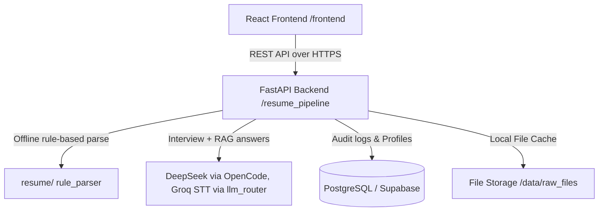

# Architecture Overview

This page summarizes the overall monorepo structure, detailing how the backend and frontend components interface with each other and the database.

---

## Monorepo Layout

The repository is structured as follows:

- **`docs_wiki/`**: Reorganized project documentation portal.
- **`deploy/`**: Docker build/push helpers and GCE bring-up notes (the only compose file lives at root `docker-compose.yml`; the database is external Supabase).
- **`frontend/`**: Single Page Application (SPA) built with React 18 and Vite 5.
- **`resume_pipeline/`**: REST API backend built with FastAPI (Python 3.11).
- **`data/raw_files/`**: Local filesystem storage holding uploaded applicant resumes and parsing metadata.

---

## Technical Stack & Component Interaction

### 1. Backend (`resume_pipeline/`)
The FastAPI application implements a standard model-schema-router architecture:
- **`app.py`**: thin composition root — app wiring, CORS, startup/shutdown, router registration (handlers live in `routers/`).
- **`db.py`**: Defines the SQLAlchemy database classes.
- **`config.py`**: Reads configuration variables from the environment.
- **`resume/`**: Rule-based offline parsing (`ingest`, `preprocess_ocr`, `segmenter`, `extractors`, `rule_parser`; `parse_service.py` facade). No `repos/` layer (deleted).

### 2. Frontend (`frontend/`)
The React application acts as the client-facing user interface:
- Communicates with the FastAPI backend using **Axios**.
- Incorporates **Framer Motion** for smooth animated transitions.
- Utilizes **Tailwind CSS** for layout styling.

### 3. Database Layer
Uses SQLAlchemy models to communicate with PostgreSQL. In production, this targets **Supabase** instances region-pooled via region-specific connection hosts.

---

## Deep Dives

For further details on specific architectural components:
- **[System Architecture details](ARCHITECTURE.md)**
- **[Database Schemas and tables](DATABASE.md)**
- **[Interview Prep simulator](INTERVIEW_SYSTEM_ARCHITECTURE.md)**
- **[Learning Path engine](LEARNING_PATH_ARCHITECTURE.md)**
- **[Live real-time WebSockets connection layer](LIVE_INTERVIEW_ARCHITECTURE.md)**
