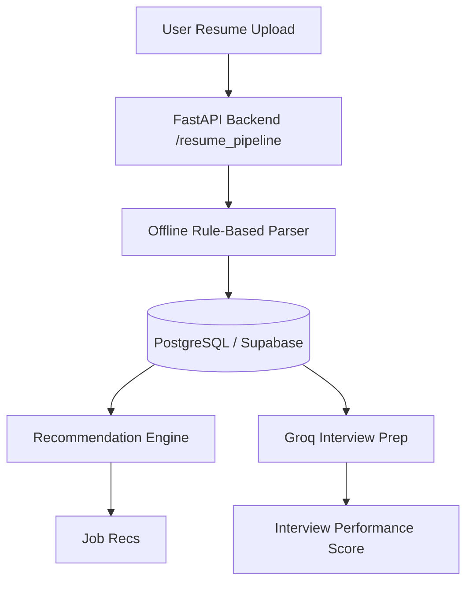

# OpenWiki: Career Guidance AI System Quickstart

Welcome to the **Career Guidance AI System** codebase wiki! This documentation is optimized for both human developers and AI coding agents to quickly understand the structure, patterns, and logic of this monorepo.

## Project Overview

The **Career Guidance AI System** is a credit-gated platform that helps students and job applicants navigate their careers by processing resumes, recommending schools and job opportunities, and providing interactive interview prep.



## Core Features
1. **Resume Parsing**: Offline rule-based pipeline (local OCR + regex/rapidfuzz extraction, no LLMs) to build detailed profiles of skills, education, and work experience.
2. **Recommendation Engine**: Custom scoring algorithm mapping parsed resumes to relevant job positions and college courses.
3. **Interview Practice**: LLM-driven chat simulator scoring candidate responses for specific roles.
4. **Credit System**: Premium actions (RAG Q&A, mock interviews, advanced parser) require credits, validated and spent via `CreditService`.

---

## Documentation Directory

Explore the codebase sub-sections:

* **[Codebase Architecture](architecture.md)**: Monorepo layout, database schema (18 ORM tables), and component interfaces.
* **[Core Workflows & Business Logic](workflows.md)**: Step-by-step detail on parsing, credit gating, and recommendation scoring.
* **[Operations & Commands](operations.md)**: Development setup, terminal commands, environment variables, and production deployment details.
* **[Testing & Verification](testing.md)**: Running backend pytest suite, mock LLM execution, and frontend lint checks.

### Detailed Design Docs (`docs/`)
For deep dives into design specifications, refer to:
- **[System Index Guide](../docs/DOCS_INDEX.md)**: Comprehensive index of existing project documentation.
- **[Quick Reference sheet](../docs/QUICK_REFERENCE.md)**: Frequently used codebase paths, commands, and rules.
- **[Security Audit Report](../docs/security_audit_report.md)**: Security findings, dependencies vulnerabilities, and remediation details.

---

## Quick Setup

To run this repository locally:

1. **Database**: Spin up PostgreSQL on port `5432` with a database named `resumes`.
2. **Backend**:
   ```powershell
   cd resume_pipeline
   ..\myenv\Scripts\Activate.ps1
   pip install -r requirements.txt
   python scripts/init_db.py
   python scripts/seed_database.py
   uvicorn resume_pipeline.app:app --reload --port 8000
   ```
3. **Frontend**:
   ```powershell
   cd frontend
   npm install
   npm run dev
   ```

*Refer to [Operations & Commands](operations.md) for detailed instructions.*
