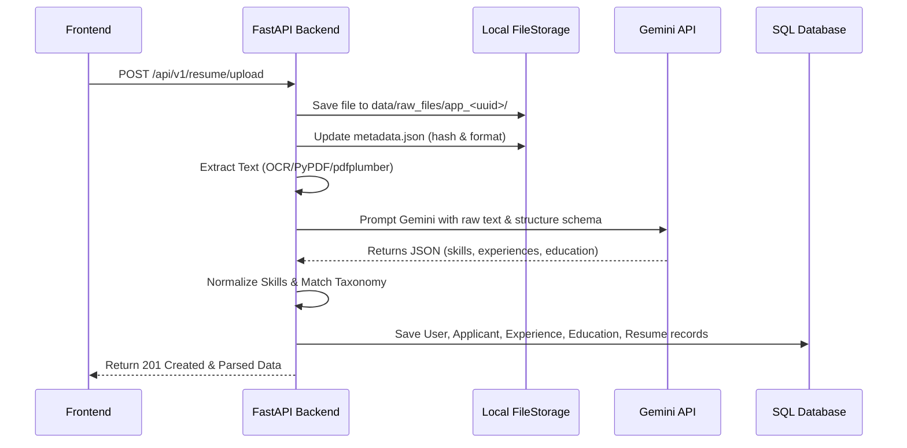

# Core Workflows & Business Logic

This document details the step-by-step logic governing the platform's core services: resume parsing, recommendation scoring, interactive interviews, and the credit billing system.

---

## 1. Resume Parsing Workflow

When an applicant uploads a resume, the backend executes the following pipeline:



### Skill Normalization Rules
* **Long Skills ($\ge$ 3 chars)**: Matched using word-boundary regex (`\bPython\b`) against the user's resume text.
* **Short Skills (< 3 chars)**: Exact substring matching to prevent false positives (e.g. matching "Go" inside "Google").

---

## 2. Recommendation Engine Scoring Workflow

The recommendation engine matches applicants to jobs and colleges based on multi-dimensional scores.

### Job Recommendation Scoring
Candidates are scored against jobs based on:
1. **Skill Match Score**: Percentage of job-required skills possessed by the applicant.
2. **Experience Alignment**: Match between the job's target roles and the applicant's experience records.
3. **Weights**: Final score is calculated using `RECOMMENDATION_WEIGHTS` defined in `constants.py`.

> [!IMPORTANT]
> **Job Visibility Constraints**: A job listing is only visible and eligible for recommendations if it has `status = 'approved'` AND its `expires_at` timestamp is in the future (`expires_at > now()`).

### College Recommendation Scoring
Students are recommended courses based on:
1. **CGPA Verification**: Student's CGPA must meet or exceed the college's `cutoff_cgpa`.
2. **Preference Match**: Matches student preferences against the college course curriculum.

---

## 3. Interactive Interview Practice Workflow

Provides mock interviews where Gemini acts as an interviewer and scores candidate responses.

1. **Initialization**: Gemini reviews candidate profile/skills and generates custom questions for the target job role.
2. **Chat Loop**: Candidate sends answers, Gemini generates natural conversation replies, asking follow-up questions.
3. **Scoring**: At the end of the session, Gemini evaluates responses on:
   * Technical accuracy
   * Communication skills
   * Job alignment
   It saves the feedback and final score to the `interview_sessions` table.

---

## 4. Credit Gating Workflow

All premium features (e.g., Gemini-powered OCR, full recommendations, mock interview sessions) are guarded by the `CreditService`.

> [!CAUTION]
> Always enforce credit checks **before** running the premium operation, and only deduct credits **after** the operation completes successfully to prevent charging users for failed API calls.

```python
# Standard code pattern for credit gating
from .core.credit_service import CreditService

# 1. Check eligibility (returns 402 HTTP error if balance insufficient)
await CreditService.check_eligibility(db, user_id, action="mock_interview")

# 2. Perform the premium action
success = await execute_premium_action(...)

# 3. Deduct credits upon success
if success:
    await CreditService.spend_credits(db, user_id, action="mock_interview")
```

---

## Detailed Workflow References (`docs/`)

For detailed technical specification of these workflows, see:
- **[Recommendation Engine Architecture](../docs/RECOMMENDATION_ENGINE_ARCHITECTURE.md)**: Breakdown of recommendation algorithms, math formulas, and weight thresholds.
- **[Interview System Architecture](../docs/INTERVIEW_SYSTEM_ARCHITECTURE.md)**: AI interviewer flow, chat states, and prompt engineering instructions.
- **[Live Interview Architecture](../docs/LIVE_INTERVIEW_ARCHITECTURE.md)**: Websocket/realtime communication setup for live interview sessions.
- **[Live Interview Roadmap](../docs/LIVE_INTERVIEW_ROADMAP.md)**: Milestone implementations and checklist for next-generation features.
- **[Resume Parse Redesign Plan](../docs/RESUME_PARSE_PIPELINE_REDESIGN.txt)**: OCR and document format extraction improvement designs.

